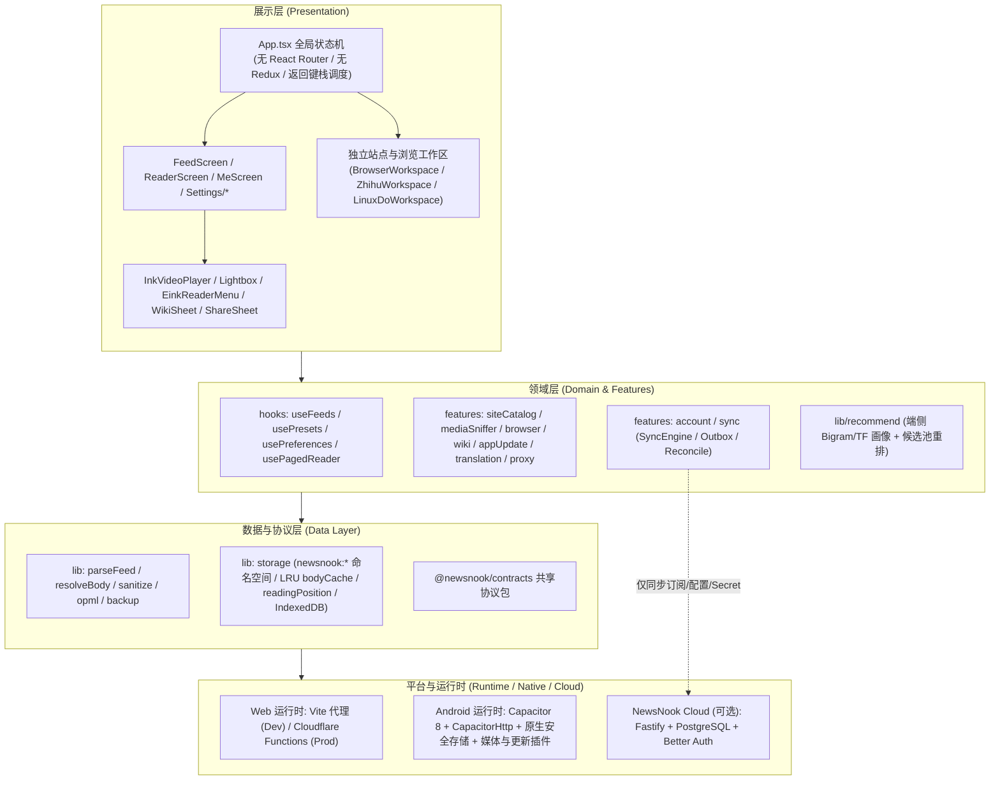

# NewsNook · 有所闻

<p align="center">
  
</p>

<p align="center">
  <strong>本地优先、站内全文、无算法茧房的跨平台现代新闻与 RSS 阅读客户端</strong>
</p>

<p align="center">
  
  
  
  
  
  
</p>

<p align="center">
  <a href="#为什么是-newsnook">为什么是 NewsNook</a> ·
  <a href="#功能">功能</a> ·
  <a href="#安装">安装</a> ·
  <a href="#开发">开发</a> ·
  <a href="#架构">架构</a> ·
  <a href="#贡献">贡献</a>
</p>

---

## 为什么是 NewsNook

> 💡 **多重形态，随需而变**：  
> 你可以把它当成一个干净纯粹的**新闻客户端**、现代优雅的 **RSS 阅读器**；  
> 也可以把它当作无算法干扰的**知乎客户端**与 **Linux.do 社区客户端**；  
> 借助强大的流媒体嗅探与内嵌播放器，你甚至可以把它当作一个好用的**影视流媒体客户端**；  
> 而配合原生油猴脚本支持与 AI 网页自动化，它更是一个注重隐私、轻巧全能的**趁手浏览器**。

在算法分发与信息流充斥的时代，现代阅读体验往往被平台的注意力收割、广告打扰与中心化推荐所绑架。NewsNook（有所闻）重归阅读本位，定位于**纯粹、强悍且本地优先的个人阅读工具**：

- 🍃 **真正的本地优先（Local-first）**：不设强制注册，不依赖中心化账户，开箱即用。断网、离线或无服务器环境下，已缓存的文章、稍后读、配置与偏好均完整可用。
- 📖 **站内全文呈现**：拒绝动辄弹窗跳转外链浏览器的割裂感。借助强大的 Readability 引擎与定制站点解析器，在应用内呈现纯净、排版精良的站内正文。
- 🛡️ **摆脱算法茧房与追踪**：主信息流绝不引入平台式热度推送或协同过滤。创新的**端侧本地推荐**完全在设备本地按阅读习惯轻度重排已订阅内容，零数据上报、零隐私泄露。
- ⚡ **硬核重磅技术矩阵**：内置二进制差分**增量更新**、多源**媒体智能嗅探**、多功能**内置浏览器与 AI Agent**、免爬虫规则的 **CMS 网页目录引擎**、以及系统级**内置百科文库**。
- 🏮 **雅致的国风美学与排版**：内置「墨问」（宣纸朱砂）、「天青」（汝窑青瓷）等多套设计方案，支持对比度算法自动推导自定义配色；深度定制正文字号、行高、段距与首行缩进。
- 📱 **墨水屏专属模式（E-ink Mode）**：针对电子墨水屏设备打造无残留、零动效的专属行为模式，支持左右三区分页触控与 Android 音量物理按键翻页。
- 🔗 **去中心化自解释分享**：分享短链基于微型自解释 Token 构建，无需依赖中心化短链数据库；边缘节点动态渲染富媒体预览卡片，发往微信、Telegram 等平台均呈现精致大图。

<p align="center">
  
  &nbsp;
  
  <br />
  <sub>速闻 · 分类轨与多源信息流（昼读墨问 / 夜读深色模式）</sub>
</p>

---

## 功能

### 1. 深度 CMS 网页目录引擎（Site Catalog & Catalog Engine）

打破传统 RSS 阅读器必须依赖 Feed 的限制，无需编写复杂的抓取规则或架设 RSSHub 中间件，客户端可直接将任意网站转化为标准信息流：

- **通用 CMS 与静态站点探测**：自动识别 WordPress、Ghost、Typecho、Hexo、Hugo、Discuz 等常见建站程序及现代单页应用框架。
- **站点能力自动发现**：
  - **栏目与分类导航**：自动发现网站的分类、专题、标签与多维筛选控件，生成原生分类切换器。
  - **排序与检索映射**：自动识别站内原生 GET/POST 搜索表单与最新/最热排序规则，直接映射为应用内原生搜索栏。
  - **智能分页提取**：自动发现 `Next Page` 链接、无限加载端点或 URL 查询分页规律，实现信息流无缝滚动翻页。
- **语义卡片与结构化数据抽取**：智能解析 HTML 文章卡片、发布时间、摘要、配图，并优先消费 `NewsArticle`、`BlogPosting`、`VideoObject` 等 JSON-LD 结构化数据，无缝转换为原生 Article 对象。

<p align="center">
  
  <br />
  <sub>Web / CMS 站点目录 · 自动发现站内分类、搜索表单与分页</sub>
</p>

### 2. 智能媒体与流媒体嗅探（Media Sniffer）

具备工业级的前端与原生混合媒体捕获能力，让网页视频回归干净的应用内播放：

- **多维度信号采集**：
  - **静态深度扫描**：解析 HTML 媒体标签、JSON-LD、嵌入式 iframe 播放页与二级跳转播放链。
  - **结构化 API 捕获**：解析 YouTube、Bilibili 及各类 CMS 播放器配置对象、`videoDetails`、音视频分离轨道与自适应流描述符。
  - **Android 原生运行时探针**：利用屏外短生命周期 WebView 监听网络请求、fetch/XHR、DOM 节点动态挂载、MSE（MediaSource）与 EME 信号。
- **URL-First 强门控过滤**：智能鉴别器剔除图片、CSS、字体、跟踪埋点等杂质信号，准确锁定真实音视频资源。
- **清单解析与自适应流支持**：
  - **HLS (`.m3u8`)**：自动解析 Master Playlist，提取多清晰度分辨率、带宽、音频语言组与字幕轨道。
  - **MPEG-DASH (`.mpd`)**：解析 Representation 容器，自动关联音视频分离轨道。
- **鉴权上下文与会话继承**：在 Android 原生流式代理中完整复用原站 Referer、Cookie、Request Headers 与 Range 头，智能绕过防盗链机制。
- **原生播放器（InkVideoPlayer）交付**：
  - **全手势交互**：双击播放/暂停、长按 2.5 倍速、全屏上下滑动调节屏幕亮度与媒体音量、横向滑动精准步进进度、双指捏合画面缩放与平移。
  - **系统级横竖屏旋转**：全屏时调用 Android Activity 系统级横屏旋转，导航手势与通知栏智能随动。
  - **全局悬浮画中画（Floating Video）**：支持将播放器脱离页面化为应用内全局悬浮小窗，自由拖拽、缩放，跨页面浏览不中断。

<p align="center">
  
  &nbsp;
  
  <br />
  <sub>InkVideoPlayer 原生媒体播放控制 与 全局应用内悬浮小窗</sub>
</p>

### 3. 全功能内置浏览器与 AI 网页自动化（Browser & Browser Agent）

集成轻量且强大的 Chromium WebView 独立浏览器工作区，超越普通外链浏览：

- **双隐私隔离模式**：
  - **无痕模式**：运行于独立的临时会话 Profile，退出即自动销毁全部 Cookie、本地存储与缓存。
  - **隐私模式**：在无痕模式基础上彻底禁用 HTTP 缓存，不留任何痕迹。
  - **隐私书签**：支持专属私密书签夹，在书签页连续点击标题 5 次隐蔽呼出。
- **多标签页与桌面版视口**：支持多标签快速切换、桌面端 User-Agent 与宽视口自适应模拟、网页内关键词高亮查找。
- **网页高清图片批量嗅探**：提供专用「图片面板」，一键提取当前网页加载的所有大图，支持快速过滤尺寸、图片预览与批量保存。
- **油猴脚本原生兼容（Userscripts）**：
  - 支持 AndroidX WebKit document-start 原生层注入，在页面脚本加载前生效。
  - 完美支持 `@match`、`@include`、`@noframes` 规则，提供应用内脚本管理器与内置预设规则。
- **AI 网页自动化代理（Browser Agent）**：
  - 基于大语言模型的自主执行引擎，具备 DOM 语义快照感知与元素引用定位能力。
  - 支持多步规划、表单自动填写、元素点击、滚动探索、页面截图与 PDF 分析导出。
  - 严格的人机协同边界：敏感操作或遇到人机验证时主动暂停交由用户审批接管。
  - 搭配 Android 前台服务与有时限的 CPU 唤醒锁，保障后台长效任务稳定运行。

<p align="center">
  
  &nbsp;
  
  &nbsp;
  
  <br />
  <sub>内置浏览器扩展能力：原生油猴脚本注入 · 网页图片批量嗅探 · 原图灯箱查看</sub>
</p>

### 4. 深度内置百科与划词文库（Built-in Encyclopedia）

告别断章取义，在阅读过程中随时拓展知识边界：

- **正文划词即查**：在阅读器内长按划选任意字词，底部瞬间唤出词条浮层，支持全屏展开与平滑拖动交互。
- **多数据源协同**：
  - **维基百科（Wikipedia）**：官方接口快速检索中文与英文维基百科。
  - **百度百科（免 API 提取）**：Android 端通过专用通道加载官方页面并实时解析 DOM，完整提取词条导语、结构化事实参数表（WikiFact）、章节目录与段落正文；自动托管人机安全挑战，用户验证后自动恢复查询。
- **结构化知识面板**：清晰整理人物/事件核心参数、多层级章节导航、关联词条推荐与原始出处链接。
- **个人百科文库（Library）**：
  - 自动保留最近查询历史（上限 50 条）。
  - 支持重点词条一键收藏管理（上限 200 条），可随时在「我的 → 划词百科」中温故知新。

### 5. 二进制差分增量更新（Incremental App Updates）

为 Android 客户端打造极致省流、极速完成的应用内更新体验：

- **GDIFF 二进制差分算法 (`gdiff-gzip-v1`)**：
  - 服务端基于前序版本的 APK 生成微型二进制差分补丁（Delta Patch）。
  - 客户端更新时无需重新下载几十兆的完整安装包，通常仅需下载几百 KB 至数 MB 的增量补丁包，带宽与耗时降低 90% 以上。
- **严密的原生原地合成与校验**：
  - 基于当前安装 APK 的精确 SHA-256 寻址匹配补丁。
  - Android 原生 `AppUpdate` 插件在本地高效应用差分补丁并重新生成新版 APK，校验最终 SHA-256 无误后唤起系统安装器。
- **双发布通道（Stable / Beta）**：支持在应用设置中自由切换正式稳定版与 Beta 尝鲜通道。
- **跨变体平滑切换**：支持在应用内直接点击「切换到完整离线版」或「切换到轻量版」，自动拉取匹配架构包覆盖安装，数据完好保留。

### 6. 多源订阅、发现与场景预设

- **通用全协议支持**：标准 RSS 2.0、Atom、RDF 与 JSON Feed。
- **OPML 极速导入导出**：支持树状分类结构完整还原，提供自建源批量归类、多选移动与暂停抓取。
- **本地 RSS 订阅商店**：
  - 基于 IndexedDB 本地快照离线检索，结合 R2 远端清单极低频静默同步。
  - 整合 Feedly 关键词发现与目标网址直连探测（Feedsearch），支持 RSSHub Radar 官方路由规则动态匹配。
  - 订阅前支持实时可用性检测与 5 篇内容试读。
- **8 大互斥主题场景预设**：
  - 深度划分「中国资讯」、「全球视野」、「财经商业」、「科技数码」、「AI 前沿」、「科学知识」、「深度人文」、「文体生活」8 套预设。
  - 内置信源全局唯一归属，杜绝重复冗余；支持分类拖拽重排与创建空白自定义预设。
- **独立站点专属工作区**：
  - **知乎独立工作区**：独立的页面导航栈与会话隔离；支持热榜、推荐、搜索、回答/文章/想法完整阅读与 AI 速读；内置本地 Smart 推荐协调层（多路召回 + 真实曝光疲劳 + 多样性重排，本地 IndexedDB 隔离，杜绝反向污染主信息流）。
  - **Linux.do 社区工作区**：支持常规话题浏览、楼层与 Threaded 树状阅读模式自由切换、分类检索与本地已读同步。

<p align="center">
  
  &nbsp;
  
  &nbsp;
  
  <br />
  <sub>场景预设切换 · 预设列表管理 · Linux.do 独立工作区（Threaded 楼层树状排版）</sub>
</p>

<p align="center">
  
  &nbsp;
  
  <br />
  <sub>综合频道信源分组管理 · 分类显隐、拖拽排序与单分类选源</sub>
</p>

### 7. 端侧智能本地推荐（Local Recommendation）

- **真正的 Backendless**：没有中心化算法服务器，不上传任何已读记录或用户画像，杜绝大数据滥用。
- **信源池边界隔离**：候选集**严格受限于当前预设已启用的信源池**，绝不跨池推荐或引入未订阅内容。
- **自然触发不抢焦**：当前预设累计阅读 5 篇后，「推荐」栏在分类轨首位自然出现，默认焦点依然停留在普通分类，不干扰常规阅读。
- **端侧画像与多样性打散**：提取已读文章标题的中文 Bigram 与英文单词 TF 词频，结合信源亲和度评分，辅以信源打散机制防刷屏；下拉刷新即可即时按最新阅读习惯重算。

### 8. 多引擎翻译与双语对照

- **原生离线端侧翻译（完整版专属）**：
  - **Google ML Kit**：Android 系统级离线语言包，模型就地运行，完全无需联网。
  - **Bergamot**：基于 Marian 离线神经网络模型（优化适配 `arm64-v8a`），极致隐私保护。
- **云端与大语言模型翻译**：
  - 支持 Google Translate、Microsoft Azure Translator、DeepL (Free/Pro)、自建 DeepLX 服务。
  - 支持 OpenAI 兼容规范的大语言模型（可自定义 Base URL、API Key 与 Model）。
- **灵活呈现模式**：支持段落下方双语对照翻译与全文直接替换；支持列表外文标题后台自动翻译与本地译文持久化。

<p align="center">
  
  &nbsp;
  
  <br />
  <sub>翻译引擎与呈现模式设置 · 阅读页原译文段落级双语对照阅读</sub>
</p>

### 9. 墨水屏专研模式（E-ink Mode）

- **纯净界面叠加**：一键开启，全局剔除过渡动画、阴影、微透模糊与纸纹质感，呈现极致黑白高对比度。
- **分区触控分页**：竖屏将屏幕横向划分为「左 28% 上一页 / 中 44% 菜单 / 右 28% 下一页」，彻底告别滑动残影与频闪刷新。
- **硬件按键翻页**：集成 Android 物理音量键翻页功能。
- **进度无损折算**：分页页码与上下滚动进度无缝等比例映射，随时切换无残留。

### 10. 设计美学与版式系统

- **古典与现代主题方案**：
  - 内置经典配色：墨问（宣纸底色 + 朱砂红）、天青（汝窑单色青釉）、现代优雅（冷白纸色 + 经典蓝）等。
  - 自由搭配跟随系统、昼读、夜读三档明暗基调。
- **智能自定义配色推导**：
  - 用户仅需自选底色与强调色两项核心色彩。
  - 系统基于 WCAG 对比度算法自动推导安全文字色、次要色、边框及浮层背景，避免低对比度辨识问题。
- **细粒度阅读排版**：支持正文字号、字体系列、行高、段间距与首行缩进多档微调。

<p align="center">
  
  &nbsp;
  
  <br />
  <sub>多套国风主题配色（墨问/天青/优雅/自定义） · 正文字号、字体与段落行高细粒度调节</sub>
</p>

### 11. 智能网络分流与安全代理

- **三档网络分流模式**：智能分流（国内直连、国际走代理）、全局代理与直连关闭。
- **原生网络隧道**：Android 端通过原生 HTTP 隧道发送请求，绕过移动 WebView 的 CORS 跨域拦截与防盗链限制。
- **流量保护机制**：支持「仅在 Wi-Fi 下自动加载正文图片与视频」，蜂窝网络下展示轻量占位块，点击按需加载。

### 12. 零服务端的站内分享

- **自解释短 Token (v2)**：仅编码原文 URL、信源 ID、精简标题与导语，整条短链形如 `https://news.aizeek.com/a/<token>`，不依赖任何短链数据库存储。
- **边缘动态 Open Graph 卡片**：Cloudflare Workers 边缘拦截爬虫请求，动态现拼包含标题、导语、来源站与首图的高清富媒体卡片，完美适配微信、WhatsApp、Telegram。
- **随机 Salt 防缓存锁死**：每次分享附加微型随机 Salt，迫使各社交软件平台重新拉取最新抓取预览。
- **应用唤醒深链**：支持 Android App Links 与自定义 Scheme（`newsnook://`），网页端附带「在有所闻 App 中打开」横幅，一键直达站内阅读器。

### 13. 离线备份与可选云同步（NewsNook Cloud）

- **完全离线的本地备份**：
  - 支持将应用偏好、场景预设、自建源、启用状态、稍后读、已读标记及阅读位置导出为标准 JSON 备份文件。
  - 恢复时支持按分区勾选整段覆盖，全程本地文件操作，不依赖外部网络与云服务。
- **可选自建云同步（NewsNook Cloud）**：
  - **自愿开通**：不登录亦可完整畅享阅读器的所有核心功能。
  - **同步边界明确**：仅同步订阅源、分类排序、场景预设、跨设备偏好与 API Key 密文；**坚决不同步**文章正文、缓存、已读记录、稍后读与阅读位置，保护设备隔离与个人隐私。
  - **高可靠同步协议**：采用单调 Revision + 本地 Outbox 影子比对增量同步机制，服务端行级排他锁串行化并发冲突；支持「使用本机 / 使用云端 / 合并」仲裁并自动创建安全回滚快照。

<p align="center">
  
  <br />
  <sub>我的 · 稍后读、最近阅读、本地搜索与偏好设置总览</sub>
</p>

---

## 安装

### Android 客户端

前往 [GitHub Releases](https://github.com/t59688/newsnook/releases) 下载最新版本安装包。NewsNook 提供两个主要变体分支，**包名与签名完全相同**，可随时互相覆盖安装或在应用内一键切换：

| 变体版本 | 产物形态与架构 | 实际安装包大小 (GitHub 最新实测) | 适用场景与特性说明 |
|---|---|---|---|
| **轻量版 (Cloud)** | 单一 Universal APK | **~6.06 MB** (AAB 约 6.99 MB) | 极致轻巧，低存储占用；支持在线翻译引擎（Google / Azure / DeepL / DeepLX）与 OpenAI 兼容大语言模型翻译 |
| **完整版 (Local)** | 架构分包：`arm64-v8a` | **~32.9 MB** | 主流现代 64 位 Android 手机推荐。包含轻量版全部功能，额外内置 **Google ML Kit** 离线翻译与 **Bergamot** 离线神经网络引擎 |
| **完整版 (Local)** | 架构分包：`armeabi-v7a` | **~18.6 MB** | 适用于老旧 32 位 ARM 设备，内置基础离线翻译库 |
| **完整版 (Local)** | 全架构 Universal APK | **~77.0 MB** (AAB 约 66.8 MB) | 集成全平台 ABI 动态库，无需判断设备架构，适合通用离线备份分发 |

*安装步骤*：
1. 从 Releases 页面下载适合设备架构的 APK 文件（绝大多数现代手机直接选择 `cloud-release.apk` 或 `local-arm64-v8a-release.apk`）。
2. 若系统提示，开启系统的「允许安装未知应用」权限。
3. 点击安装并打开应用即可，无需注册登录。
4. 后续更新可通过内置的**增量更新**功能自动拉取差分包进行原地升级。

### Web 网页版

NewsNook 前端完全支持现代桌面与移动端浏览器访问，支持 PWA 安装与全屏阅读体验（生产环境由 Cloudflare Pages 提供边缘托管与反向代理）。

### NewsNook Cloud（可选自建同步后端）

若希望在多台设备间自动同步订阅与偏好设置，可通过 Docker Compose 自建同步后端：

```bash
cd cloud
cp .env.example .env
# 填写 DATABASE_URL、BETTER_AUTH_SECRET、NEWSNOOK_DATA_ENCRYPTION_KEY 等必要变量
./deploy db migrate   # 运行 PostgreSQL 数据库迁移
./deploy up           # 启动 Fastify 同步服务
```

---

## 开发

### 环境准备

- **Node.js**：22.0.0 或更高版本
- **包管理器**：npm
- **Android 构建依赖**（仅打包 Android 原生客户端时需要）：
  - Android SDK (API 36, Build Tools 36)
  - JDK 21 (推荐使用 Android Studio 内置 JBR)

### 快速上手

```bash
# 1. 克隆仓库
git clone https://github.com/t59688/newsnook.git
cd newsnook

# 2. 安装项目依赖
npm install

# 3. 启动本地开发服务（包含 Vite 接口代理）
npm run dev
```

启动后访问 `http://localhost:5173` 即可进行 Web 调试。

### 常用命令

| 脚本命令 | 说明 |
|---|---|
| `npm run dev` | 启动 Web 开发服务器（自动构建共享 contracts 并提供 /api 代理） |
| `npm run build` | 生产环境完整构建（编译 contracts、提取字体子集、tsc 校验、Vite 打包） |
| `npm run lint` | 使用 oxlint 进行全项目高速代码静态检查 |
| `npm run android:sync` | 编译前端静态资源并同步到 Android 原生工程 |
| `npm run android:run` | 同步并启动 Android **轻量版**（Cloud 变体） |
| `npm run android:run:local` | 同步并启动 Android **完整版**（Local 变体） |
| `npm run bergamot:init` | 初始化拉取 Bergamot 原生离线模型与 JNI 资产 |
| `npm run android:apk` | 构建签名的 Release APK（默认输出 cloud 与 local 两个变体） |
| `npm run android:aab` | 构建签名的 Release AAB（用于 Google Play 上架） |
| `npm run android:keystore:init` | 本机签名证书与环境文件初始化（仅初次配置执行一次） |
| `npm run cloud:migrate` | 运行云端同步服务的数据库迁移 |
| `npm run cloud:build` | 编译云端 Fastify 同步服务 |

### 核心自动化测试

针对解析、翻译、同步与安全关键逻辑，项目提供了丰富的测试套件：

```bash
npm run test:site-catalog        # CMS 网页目录引擎与能力探测测试
npm run test:video-player        # 媒体嗅探器 (Media Sniffer) 与播放器交互测试
npm run test:browser             # 内置浏览器工作区、隐私模式与 Agent 测试
npm run test:app-update          # 增量差分更新逻辑与 ABI 匹配测试
npm run test:wiki                # 划词百科提取、百度百科与文库测试
npm run test:json-feed           # JSON Feed 规范解析测试
npm run test:resolve-body        # 站内正文智能提取回归测试
npm run test:translation         # 翻译引擎与对照呈现测试
npm run test:recommend           # 端侧本地推荐打分与打散逻辑测试
npm run test:eink                # 墨水屏模式分页与翻页测试
npm run test:sync-engine         # 云同步引擎 Outbox 与冲突消解测试
npm run test:share-og            # 社交分享卡片与 Token 编解码测试
```

---

## 架构

NewsNook 遵循严格的自上而下分层依赖规范，运行时真相牢牢扎根于客户端本地：



### 关键架构约束

1. **零外部状态库**：全应用状态由 `App.tsx` 顶级状态机与纯函数 Hooks 驱动，坚决不引入 Redux、Zustand 等复杂全局状态管理，保持代码透明、轻盈且易于维护。
2. **客户端直连上游**：新闻列表与正文解析由客户端直连目标站点，没有中心化的正文转存中间件；即便 NewsNook Cloud 完全停机，客户端阅读体验丝毫不受影响。
3. **数据隔离与安全性**：
   - 存储统一前缀 `newsnook:`，正文缓存执行 3MB 容量预算控制，避免撑爆设备存储。
   - 敏感密钥（第三方 API Key、代理账密）在 Android 端强制存放于系统 Keystore 加密的 `SecureStore` 中，日志永不打印明文 Secret。
   - 独立工作区（浏览器会话、知乎、Linux.do）的会话、草稿与私信全部由独立的 IndexedDB 隔离持久化，严禁回写或污染主信息流。

---

## 贡献

我们热忱欢迎社区开发者参与 NewsNook 的建设！无论是修复一个失效的源，还是改善无障碍体验，你的贡献都意义非凡。

### 欢迎的贡献方向

- 🛠️ 修复失效的内置信源、RSS 解析异常或正文清洗漏洞。
- 🌐 改进翻译引擎、新增符合规范的 `TranslationProvider`。
- 📺 增强流媒体嗅探器（Media Sniffer）与播放器手势/格式兼容性。
- 🔍 丰富 CMS 网页目录（Site Catalog）提取适配能力。
- 📱 针对特定墨水屏设备的刷新、翻页或高对比度无障碍适配。
- 🎨 提交典雅、具有设计美感的新阅读配色方案。
- ⚡ 性能优化、崩溃防护与多端 WebView 兼容性提升。

### 提交流程

1. **Fork 本仓库** 并基于最新的 `beta` 或主分支检出特性分支。
2. **保持最小必要改动**：单一 PR 仅聚焦解决一个明确的问题，避免附带大范围不相关的代码格式化或架构重构。
3. **代码与文案风格**：
   - 面向用户的 UI 文案、说明提示一律使用规范、温和的**中文**；
   - 内部变量、函数、接口和代码注释保持既有的**英文**工程风格。
   - 业务代码严禁直接使用 `console.*`，统一使用 `lib/logger.ts` 中的 `log.<namespace>`。
4. **验证与测试**：涉及解析、翻译、媒体或同步改动时，确保运行并通过对应的 `npm run test:*` 脚本及 `npm run lint`。
5. **提交 PR**：清晰阐述改动动机、实现方案及测试验证步骤。若需引入新的生产依赖，需在 PR 中详细说明必要性。

### 开源协议

NewsNook 遵循 **[AGPL-3.0-or-later](LICENSE)** 开源许可证。
